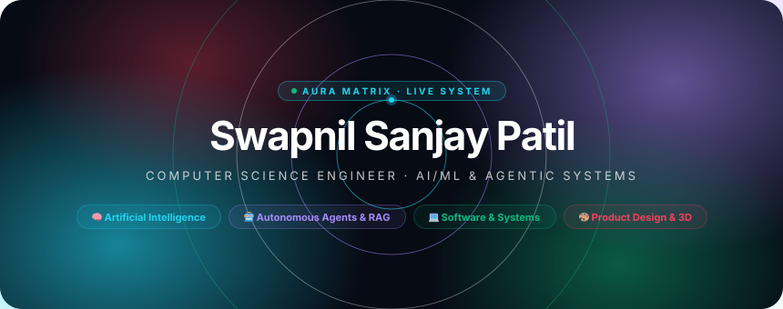
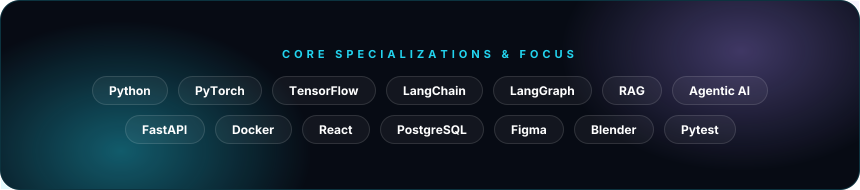
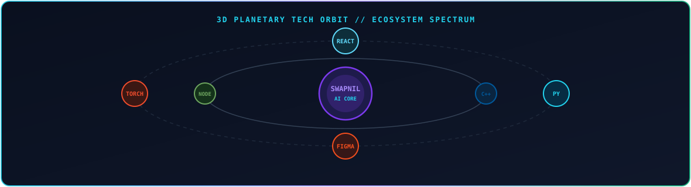

<div align="center">



<br/>

<!-- Phase 1: Animated 3D Custom Hero Banner with Vector Typing Text -->

<picture>
  <source media="(prefers-color-scheme: dark)" srcset="./header_hero_dark.svg">
  <source media="(prefers-color-scheme: light)" srcset="./header_hero_light.svg">
  
</picture>

<br/><br/>

<!-- Phase 2: Animated Live Terminal HUD Banner -->

<picture>
  <source media="(prefers-color-scheme: dark)" srcset="./dark.svg">
  <source media="(prefers-color-scheme: light)" srcset="./light.svg">
  
</picture>

<br/><br/>

<!-- Phase 3: Dynamic Neon Typing Sub-Banner -->

<p align="center">
  <a href="https://github.com/swapnil3104">
    
  </a>
</p>

<br/>

<!-- Aura Glassmorphic Interactive Social Dock -->

<p align="center">
<a href="https://linkedin.com/in/swapnil-sanjay-patil3104"></a><a href="https://github.com/swapnil3104"></a><a href="https://x.com/PatilSwap3104"></a><a href="https://instagram.com/patilswap3104"></a><a href="https://reddit.com/user/u/Individual_Letter952"></a><a href="mailto:swapnilp3104@gmail.com"></a>
</p>

</div>

<br/>

<!-- Animated SVG Theme-Aware Section Divider -->

<picture>
  <source media="(prefers-color-scheme: dark)" srcset="./divider_dark.svg">
  <source media="(prefers-color-scheme: light)" srcset="./divider_light.svg">
  
</picture>

### ⚡ About Me

```yaml
sys.user: Swapnil Sanjay Patil
sys.role: Computer Science Engineer
sys.specializations:
  - Artificial Intelligence & Machine Learning (AI/ML)
  - Data Analytics & Predictive Modeling
  - Product Design & Interactive Front-End Development
sys.status: "Building + Learning + Shipping 🚀"
sys.philosophy: "Solving real-world problems through clean code, data, & creative UI."
```

<br/>

<!-- Aura Cyber Bento Grid Card -->



<br/>

<!-- Separate Animation 1: Animated Cyber Terminal Simulator -->

<picture>
  <source media="(prefers-color-scheme: dark)" srcset="./terminal_sim_dark.svg">
  <source media="(prefers-color-scheme: light)" srcset="./terminal_sim_light.svg">
  
</picture>

<br/>

<!-- Animated SVG Theme-Aware Section Divider -->

<picture>
  <source media="(prefers-color-scheme: dark)" srcset="./divider_dark.svg">
  <source media="(prefers-color-scheme: light)" srcset="./divider_light.svg">
  
</picture>

### 🛠️ Tech Stack & Visual Ecosystem

<!-- Aura Core Technologies Card -->



<br/>

<!-- Unified SkillIcons Vector Graphics Grid -->

<div align="center">

<p align="center">
  <a href="https://skillicons.dev">
    
  </a>
</p>

</div>

<br/>

<!-- Separate Animation 2: Animated 3D Tech Orbit Planetary Card -->

<picture>
  <source media="(prefers-color-scheme: dark)" srcset="./tech_orbit_dark.svg">
  <source media="(prefers-color-scheme: light)" srcset="./tech_orbit_light.svg">
  
</picture>

<br/>

#### 🧠 Artificial Intelligence, Machine Learning & Data Science

<p>
  
  
  
  
  
  
  
  
  
  
  
</p>

#### 💻 Software & Web Engineering

<p>
  
  
  
  
  
  
  
  
  
  
  
  
</p>

#### 🗄️ Databases & Systems

<p>
  
  
  
  
</p>

#### 🎨 Product Designer & 3D Modeling

<p>
  
  
  
  
  
  
</p>

#### 🛠️ Tools & Version Control

<p>
  
  
</p>

#### 🤖 Large Language Models (LLMs) & Generative AI

<p>
  
  
  
  
  
  
  
  
  
</p>

#### 🔍 Retrieval-Augmented Generation (RAG)

<p>
  
  
  
  
  
  
  
  
  
  
  
  
</p>

#### 🤖 AI Agents & Agentic AI (Learning)

<p>
  
  
  
  
  
  
  
  
  
  
  
  
</p>

#### 👁️ Deep Learning & Computer Vision

<p>
  
  
  
  
  
  
</p>

#### ⚡ Backend Development & APIs (Basics)

<p>
  
  
  
  
  
  
  
  
</p>

#### ☁️ Cloud Computing & Deployment

<p>
  
  
  
  
  
</p>

#### 🐳 DevOps & Containerization

<p>
  
  
  
</p>

#### 🧪 Testing & Code Quality

<p>
  
</p>

<details>
<summary><b>📑 View Detailed Tech Stack Breakdown & Categorized Directory</b></summary>
<br/>

| Domain / Category | Technologies & Tools |
| :--- | :--- |
| **🧠 Artificial Intelligence, Machine Learning & Data Science** | 1. Python • 2. PyTorch • 3. TensorFlow • 4. OpenCV • 5. Scikit-learn • 6. NumPy • 7. Pandas • 8. Matplotlib • 9. Plotly • 10. MLflow • 11. Anaconda |
| **💻 Software & Web Engineering** | 1. C • 2. C++ • 3. JavaScript • 4. React • 5. React Native • 6. Vite • 7. Three.js • 8. Node.js • 9. PHP • 10. HTML5 • 11. CSS3 • 12. WordPress |
| **🗄️ Databases & Systems** | 1. PostgreSQL • 2. MySQL • 3. SQLite • 4. MongoDB |
| **🎨 Product Designer & 3D Modeling** | 1. Figma • 2. Adobe Photoshop • 3. Adobe XD • 4. Blender • 5. Canva • 6. CorelDRAW |
| **🛠️ Tools & Version Control** | 1. Git • 2. GitHub |
| **🤖 Large Language Models (LLMs) & Generative AI** | 1. LangChain • 2. LlamaIndex • 3. Hugging Face • 4. Ollama • 5. OpenAI API • 6. Google Gemini API • 7. Anthropic Claude API • 8. Groq API • 9. Transformers |
| **🔍 Retrieval-Augmented Generation (RAG)** | 1. ChromaDB • 2. FAISS • 3. Pinecone • 4. Weaviate • 5. Qdrant • 6. Milvus • 7. Elasticsearch • 8. Azure AI Search • 9. BGE Embeddings • 10. Sentence Transformers • 11. Cohere Rerank • 12. RAGAS |
| **🤖 AI Agents & Agentic AI (Learning)** | 1. LangGraph • 2. CrewAI • 3. AutoGen • 4. Microsoft Agent Framework • 5. OpenAI Agents SDK • 6. Semantic Kernel • 7. Agno • 8. Pydantic AI • 9. MCP (Model Context Protocol) • 10. Function Calling • 11. Tool Calling • 12. Multi-Agent Systems |
| **👁️ Deep Learning & Computer Vision** | 1. Keras • 2. YOLO • 3. MediaPipe • 4. torchvision • 5. TensorRT • 6. Ultralytics |
| **⚡ Backend Development & APIs (Basics)** | 1. Django • 2. Django REST Framework • 3. Flask • 4. FastAPI • 5. Express.js • 6. NestJS • 7. REST API • 8. WebSockets |
| **☁️ Cloud Computing & Deployment** | 1. Vercel • 2. Netlify • 3. Hugging Face Spaces • 4. Google Colab • 5. Kaggle |
| **🐳 DevOps & Containerization** | 1. Docker • 2. Kubernetes • 3. CI/CD |
| **🧪 Testing & Code Quality** | 1. Pytest |

</details>

<br/>

<!-- Animated SVG Theme-Aware Section Divider -->

<picture>
  <source media="(prefers-color-scheme: dark)" srcset="./divider_dark.svg">
  <source media="(prefers-color-scheme: light)" srcset="./divider_light.svg">
  
</picture>

### 🏆 GitHub Achievements

<div align="center">

<!-- Official GitHub Achievement Badges -->

<p align="center">
  <a href="https://github.com/swapnil3104?tab=achievements" title="GitHub Achievements">
    
  </a>
  &nbsp;&nbsp;
  <a href="https://github.com/swapnil3104?tab=achievements" title="GitHub Achievements">
    
  </a>
  &nbsp;&nbsp;
  <a href="https://github.com/swapnil3104?tab=achievements" title="GitHub Achievements">
    
  </a>
  &nbsp;&nbsp;
  <a href="https://github.com/swapnil3104?tab=achievements" title="GitHub Achievements">
    
  </a>
  &nbsp;&nbsp;
  <a href="https://github.com/swapnil3104?tab=achievements" title="GitHub Achievements">
    
  </a>
  &nbsp;&nbsp;
  <a href="https://github.com/swapnil3104?tab=achievements" title="GitHub Achievements">
    
  </a>
</p>

<br/>

<!-- Direct Link Button Badge -->

[](https://github.com/swapnil3104?tab=achievements)

</div>

<br/>

<!-- Animated SVG Theme-Aware Section Divider -->

<picture>
  <source media="(prefers-color-scheme: dark)" srcset="./divider_dark.svg">
  <source media="(prefers-color-scheme: light)" srcset="./divider_light.svg">
  
</picture>

### 📊 GitHub Activity & Performance Metrics

<!-- Streak Card -->


<br/><br/>

<!-- Stats & Top Languages Side-by-Side -->

<table border="0" width="100%">
  <tr>
    <td width="50%" valign="top">
      
    </td>
    <td width="50%" valign="top">
      
    </td>
  </tr>
</table>

<br/>

<!-- Activity & Profile Dashboard -->


<br/>

> *Note: `hide_rank=true` is enabled because star-weighted GitHub rank metric can be inaccurate for actively growing accounts.*

<br/>

<!-- Animated SVG Theme-Aware Section Divider -->

<picture>
  <source media="(prefers-color-scheme: dark)" srcset="./divider_dark.svg">
  <source media="(prefers-color-scheme: light)" srcset="./divider_light.svg">
  
</picture>

### 🐍 Contribution Activity (Snake Animation)

<!-- Theme-Aware Snake Animation -->

<picture>
  <source media="(prefers-color-scheme: dark)" srcset="https://raw.githubusercontent.com/swapnil3104/swapnil3104/output/github-contribution-grid-snake-dark.svg">
  <source media="(prefers-color-scheme: light)" srcset="https://raw.githubusercontent.com/swapnil3104/swapnil3104/output/github-contribution-grid-snake.svg">
  
</picture>

<br/>

<!-- Animated SVG Theme-Aware Section Divider -->

<picture>
  <source media="(prefers-color-scheme: dark)" srcset="./divider_dark.svg">
  <source media="(prefers-color-scheme: light)" srcset="./divider_light.svg">
  
</picture>

<div align="center">

<!-- Profile Visitor Counter -->


<br/>

<sub>⚡ Built with precision according to the GitHub Profile Master Pipeline & readme-aura</sub>

</div>
