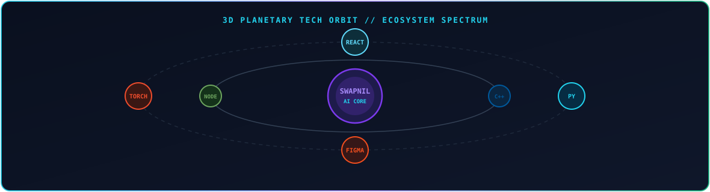

<div align="center">

```aura width=860 height=340
<div style={{ position: 'relative', display: 'flex', flexDirection: 'column', alignItems: 'center', justifyContent: 'center', width: '100%', height: '100%', background: '#070B14', borderRadius: 24, overflow: 'hidden', fontFamily: 'Inter, sans-serif' }}>
  <style>{`
    @keyframes orb-cyan { 0%, 100% { transform: translate(0, 0); opacity: 0.6; } 50% { transform: translate(35px, -25px); opacity: 0.95; } }
    @keyframes orb-violet { 0%, 100% { transform: translate(0, 0); opacity: 0.55; } 50% { transform: translate(-30px, 20px); opacity: 0.85; } }
    @keyframes orb-emerald { 0%, 100% { transform: translate(0, 0); opacity: 0.4; } 50% { transform: translate(22px, -30px); opacity: 0.75; } }
    @keyframes orb-rose { 0%, 100% { transform: translate(0, 0); opacity: 0.35; } 50% { transform: translate(-20px, -20px); opacity: 0.7; } }
    @keyframes ring-pulse-1 { 0%, 100% { opacity: 0.08; } 50% { opacity: 0.28; } }
    @keyframes ring-pulse-2 { 0%, 100% { opacity: 0.05; } 50% { opacity: 0.20; } }
    @keyframes beacon-spin { 0% { transform: rotate(0deg); } 100% { transform: rotate(360deg); } }
    @keyframes badge-pulse { 0%, 100% { transform: scale(1); opacity: 0.9; } 50% { transform: scale(1.04); opacity: 1; } }
    #aura-h-o1 { animation: orb-cyan 9s ease-in-out infinite; }
    #aura-h-o2 { animation: orb-violet 11s ease-in-out infinite 0.7s; }
    #aura-h-o3 { animation: orb-emerald 8s ease-in-out infinite 1.8s; }
    #aura-h-o4 { animation: orb-rose 10s ease-in-out infinite 2.5s; }
    #aura-hr1 { animation: ring-pulse-1 7s ease-in-out infinite; }
    #aura-hr2 { animation: ring-pulse-1 7s ease-in-out infinite 1.5s; }
    #aura-hr3 { animation: ring-pulse-2 8s ease-in-out infinite 3.0s; }
    #aura-hr4 { animation: ring-pulse-2 9s ease-in-out infinite 4.5s; }
    #aura-beacon { animation: beacon-spin 16s linear infinite; }
    #live-badge { animation: badge-pulse 3s ease-in-out infinite; }
  `}</style>

  <svg width="860" height="340" style={{ position: 'absolute', top: 0, left: 0 }}>
    <defs>
      <radialGradient id="ag-cyan" cx="50%" cy="50%" r="50%">
        <stop offset="0%" stopColor="rgba(34,211,238,0.6)" />
        <stop offset="100%" stopColor="rgba(34,211,238,0)" />
      </radialGradient>
      <radialGradient id="ag-violet" cx="50%" cy="50%" r="50%">
        <stop offset="0%" stopColor="rgba(167,139,250,0.55)" />
        <stop offset="100%" stopColor="rgba(167,139,250,0)" />
      </radialGradient>
      <radialGradient id="ag-emerald" cx="50%" cy="50%" r="50%">
        <stop offset="0%" stopColor="rgba(16,185,129,0.45)" />
        <stop offset="100%" stopColor="rgba(16,185,129,0)" />
      </radialGradient>
      <radialGradient id="ag-rose" cx="50%" cy="50%" r="50%">
        <stop offset="0%" stopColor="rgba(244,63,94,0.35)" />
        <stop offset="100%" stopColor="rgba(244,63,94,0)" />
      </radialGradient>
    </defs>
    <ellipse id="aura-h-o1" cx="130" cy="270" rx="270" ry="200" fill="url(#ag-cyan)" />
    <ellipse id="aura-h-o2" cx="740" cy="90"  rx="250" ry="190" fill="url(#ag-violet)" />
    <ellipse id="aura-h-o3" cx="680" cy="290" rx="210" ry="160" fill="url(#ag-emerald)" />
    <ellipse id="aura-h-o4" cx="210" cy="70"  rx="190" ry="140" fill="url(#ag-rose)" />

    <circle id="aura-hr1" cx="430" cy="170" r="60"  fill="none" stroke="rgba(34,211,238,0.7)" strokeWidth="0.8" />
    <circle id="aura-hr2" cx="430" cy="170" r="110" fill="none" stroke="rgba(167,139,250,0.6)" strokeWidth="0.8" />
    <circle id="aura-hr3" cx="430" cy="170" r="170" fill="none" stroke="rgba(255,255,255,0.4)" strokeWidth="0.8" />
    <circle id="aura-hr4" cx="430" cy="170" r="240" fill="none" stroke="rgba(16,185,129,0.4)" strokeWidth="0.8" />

    <g id="aura-beacon">
      <circle cx="430" cy="110" r="3" fill="#22D3EE" />
      <circle cx="430" cy="110" r="6" fill="rgba(34,211,238,0.3)" />
    </g>
  </svg>

  <div style={{ position: 'relative', display: 'flex', flexDirection: 'column', alignItems: 'center', zIndex: 10 }}>
    <div id="live-badge" style={{ display: 'flex', alignItems: 'center', padding: '4px 14px', background: 'rgba(34,211,238,0.1)', border: '1px solid rgba(34,211,238,0.35)', borderRadius: 100, marginBottom: 14, gap: 6 }}>
      <div style={{ width: 6, height: 6, borderRadius: 10, background: '#10B981' }} />
      <span style={{ fontSize: 10, color: '#22D3EE', letterSpacing: 2.5, textTransform: 'uppercase', fontWeight: 700 }}>AURA MATRIX · LIVE SYSTEM</span>
    </div>

    <span style={{ fontSize: 44, fontWeight: 800, color: '#FFFFFF', letterSpacing: -1.5, lineHeight: 1.1 }}>Swapnil Sanjay Patil</span>
    <span style={{ fontSize: 13, color: 'rgba(255,255,255,0.75)', marginTop: 12, letterSpacing: 3, textTransform: 'uppercase', fontWeight: 500 }}>Computer Science Engineer · AI/ML & Agentic Systems</span>

    <div style={{ display: 'flex', flexWrap: 'wrap', gap: 8, marginTop: 24, justifyContent: 'center' }}>
      <span style={{ padding: '6px 16px', background: 'rgba(34,211,238,0.08)', color: '#22D3EE', borderRadius: 100, fontSize: 11, border: '1px solid rgba(34,211,238,0.25)', fontWeight: 600 }}>🧠 Artificial Intelligence</span>
      <span style={{ padding: '6px 16px', background: 'rgba(167,139,250,0.08)', color: '#A78BFA', borderRadius: 100, fontSize: 11, border: '1px solid rgba(167,139,250,0.25)', fontWeight: 600 }}>🤖 Autonomous Agents & RAG</span>
      <span style={{ padding: '6px 16px', background: 'rgba(16,185,129,0.08)', color: '#10B981', borderRadius: 100, fontSize: 11, border: '1px solid rgba(16,185,129,0.25)', fontWeight: 600 }}>💻 Software & Systems</span>
      <span style={{ padding: '6px 16px', background: 'rgba(244,63,94,0.08)', color: '#F43F5E', borderRadius: 100, fontSize: 11, border: '1px solid rgba(244,63,94,0.25)', fontWeight: 600 }}>🎨 Product Design & 3D</span>
    </div>
  </div>
</div>
```

<br/>

<!-- Phase 1: Animated 3D Custom Hero Banner with Vector Typing Text -->
<picture>
  <source media="(prefers-color-scheme: dark)" srcset="./header_hero_dark.svg">
  <source media="(prefers-color-scheme: light)" srcset="./header_hero_light.svg">
  
</picture>

<br/><br/>

<!-- Phase 2: Animated Live Terminal HUD Banner -->
<picture>
  <source media="(prefers-color-scheme: dark)" srcset="./dark.svg">
  <source media="(prefers-color-scheme: light)" srcset="./light.svg">
  
</picture>

<br/><br/>

<!-- Phase 3: Dynamic Neon Typing Sub-Banner -->
<p align="center">
  <a href="https://github.com/swapnil3104">
    
  </a>
</p>

<br/>

<!-- Aura Glassmorphic Interactive Social Dock -->
```aura width=142 height=42 link="https://linkedin.com/in/swapnil-sanjay-patil3104" inline align=center
<div style={{ display: 'flex', width: '100%', height: '100%', padding: '0 4px' }}>
  <div style={{ display: 'flex', alignItems: 'center', justifyContent: 'center', width: '100%', height: '100%', background: 'linear-gradient(135deg, rgba(34,211,238,0.12) 0%, rgba(10,102,194,0.25) 100%)', borderRadius: 10, border: '1px solid rgba(34,211,238,0.4)', gap: 7, padding: '0 12px', fontFamily: 'Inter, sans-serif' }}>
    <svg width="15" height="15" viewBox="0 0 24 24" fill="#0A66C2"><path d="M19 3a2 2 0 0 1 2 2v14a2 2 0 0 1-2 2H5a2 2 0 0 1-2-2V5a2 2 0 0 1 2-2h14m-.5 15.5v-5.3a3.26 3.26 0 0 0-3.26-3.26c-.85 0-1.84.52-2.28 1.3v-1.11h-2.79v8.37h2.79v-4.93c0-.77.62-1.4 1.39-1.4a1.4 1.4 0 0 1 1.4 1.4v4.93h2.75M6.88 8.56a1.68 1.68 0 0 0 1.68-1.68c0-.93-.75-1.69-1.68-1.69a1.69 1.69 0 0 0-1.69 1.69c0 .93.76 1.68 1.69 1.68m1.39 9.94v-8.37H5.5v8.37h2.77z"/></svg>
    <span style={{ color: '#FFFFFF', fontSize: 12, fontWeight: 600 }}>LinkedIn</span>
  </div>
</div>
```
```aura width=134 height=42 link="https://github.com/swapnil3104" inline align=center
<div style={{ display: 'flex', width: '100%', height: '100%', padding: '0 4px' }}>
  <div style={{ display: 'flex', alignItems: 'center', justifyContent: 'center', width: '100%', height: '100%', background: 'linear-gradient(135deg, rgba(255,255,255,0.08) 0%, rgba(18,16,17,0.4) 100%)', borderRadius: 10, border: '1px solid rgba(255,255,255,0.25)', gap: 7, padding: '0 12px', fontFamily: 'Inter, sans-serif' }}>
    <svg width="15" height="15" viewBox="0 0 24 24" fill="#FFFFFF"><path d="M12 2A10 10 0 0 0 2 12c0 4.42 2.87 8.17 6.84 9.5.5.08.66-.23.66-.5v-1.69c-2.77.6-3.36-1.34-3.36-1.34-.46-1.16-1.11-1.47-1.11-1.47-.91-.62.07-.6.07-.6 1 .07 1.53 1.03 1.53 1.03.87 1.52 2.34 1.07 2.91.83.09-.65.35-1.09.63-1.34-2.22-.25-4.55-1.11-4.55-4.92 0-1.11.38-2 1.03-2.71-.1-.25-.45-1.29.1-2.64 0 0 .84-.27 2.75 1.02.79-.22 1.65-.33 2.5-.33.85 0 1.71.11 2.5.33 1.91-1.29 2.75-1.02 2.75-1.02.55 1.35.2 2.39.1 2.64.65.71 1.03 1.6 1.03 2.71 0 3.82-2.34 4.66-4.57 4.91.36.31.69.92.69 1.85V21c0 .27.16.59.67.5C19.14 20.16 22 16.42 22 12A10 10 0 0 0 12 2z"/></svg>
    <span style={{ color: '#FFFFFF', fontSize: 12, fontWeight: 600 }}>GitHub</span>
  </div>
</div>
```
```aura width=118 height=42 link="https://x.com/PatilSwap3104" inline align=center
<div style={{ display: 'flex', width: '100%', height: '100%', padding: '0 4px' }}>
  <div style={{ display: 'flex', alignItems: 'center', justifyContent: 'center', width: '100%', height: '100%', background: 'linear-gradient(135deg, rgba(255,255,255,0.06) 0%, rgba(0,0,0,0.5) 100%)', borderRadius: 10, border: '1px solid rgba(255,255,255,0.2)', gap: 7, padding: '0 12px', fontFamily: 'Inter, sans-serif' }}>
    <svg width="14" height="14" viewBox="0 0 24 24" fill="#FFFFFF"><path d="M18.244 2.25h3.308l-7.227 8.26 8.502 11.24H16.17l-5.214-6.817L4.99 21.75H1.68l7.73-8.835L1.254 2.25H8.08l4.713 6.231zm-1.161 17.52h1.833L7.084 4.126H5.117z"/></svg>
    <span style={{ color: '#FFFFFF', fontSize: 12, fontWeight: 600 }}>X.com</span>
  </div>
</div>
```
```aura width=142 height=42 link="https://instagram.com/patilswap3104" inline align=center
<div style={{ display: 'flex', width: '100%', height: '100%', padding: '0 4px' }}>
  <div style={{ display: 'flex', alignItems: 'center', justifyContent: 'center', width: '100%', height: '100%', background: 'linear-gradient(135deg, rgba(228,64,95,0.15) 0%, rgba(131,58,180,0.25) 100%)', borderRadius: 10, border: '1px solid rgba(228,64,95,0.4)', gap: 7, padding: '0 12px', fontFamily: 'Inter, sans-serif' }}>
    <svg width="15" height="15" viewBox="0 0 24 24" fill="#E4405F"><path d="M12 2.163c3.204 0 3.584.012 4.85.07 3.252.148 4.771 1.691 4.919 4.919.058 1.265.069 1.645.069 4.849 0 3.205-.012 3.584-.069 4.849-.149 3.225-1.664 4.771-4.919 4.919-1.266.058-1.644.07-4.85.07-3.204 0-3.584-.012-4.849-.07-3.26-.149-4.771-1.699-4.919-4.92-.058-1.265-.07-1.644-.07-4.849 0-3.204.013-3.583.07-4.849.149-3.227 1.664-4.771 4.919-4.919 1.266-.057 1.645-.069 4.849-.069zm0-2.163c-3.259 0-3.667.014-4.947.072-4.358.2-6.78 2.618-6.98 6.98-.059 1.281-.073 1.689-.073 4.948 0 3.259.014 3.668.072 4.948.2 4.358 2.618 6.78 6.98 6.98 1.281.058 1.689.072 4.948.072 3.259 0 3.668-.014 4.948-.072 4.354-.2 6.782-2.618 6.979-6.98.059-1.28.073-1.689.073-4.948 0-3.259-.014-3.667-.072-4.947-.196-4.354-2.617-6.78-6.979-6.98-1.281-.059-1.69-.073-4.949-.073zm0 5.838c-3.403 0-6.162 2.759-6.162 6.162s2.759 6.163 6.162 6.163 6.162-2.759 6.162-6.163c0-3.403-2.759-6.162-6.162-6.162zm0 10.162c-2.209 0-4-1.79-4-4 0-2.209 1.791-4 4-4s4 1.791 4 4c0 2.21-1.791 4-4 4zm6.406-11.845c-.796 0-1.441.645-1.441 1.44s.645 1.44 1.441 1.44c.795 0 1.439-.645 1.439-1.44s-.644-1.44-1.439-1.44z"/></svg>
    <span style={{ color: '#FFFFFF', fontSize: 12, fontWeight: 600 }}>Instagram</span>
  </div>
</div>
```
```aura width=132 height=42 link="https://reddit.com/user/u/Individual_Letter952" inline align=center
<div style={{ display: 'flex', width: '100%', height: '100%', padding: '0 4px' }}>
  <div style={{ display: 'flex', alignItems: 'center', justifyContent: 'center', width: '100%', height: '100%', background: 'linear-gradient(135deg, rgba(255,69,0,0.15) 0%, rgba(200,40,0,0.25) 100%)', borderRadius: 10, border: '1px solid rgba(255,69,0,0.4)', gap: 7, padding: '0 12px', fontFamily: 'Inter, sans-serif' }}>
    <svg width="15" height="15" viewBox="0 0 24 24" fill="#FF4500"><path d="M12 0A12 12 0 0 0 0 12a12 12 0 0 0 12 12 12 12 0 0 0 12-12A12 12 0 0 0 12 0zm5.01 4.744c.688 0 1.25.561 1.25 1.249a1.25 1.25 0 0 1-2.498.056l-2.597-.547-.8 3.747c1.824.07 3.48.632 4.674 1.488.308-.309.73-.491 1.207-.491.968 0 1.754.786 1.754 1.754 0 .716-.435 1.333-1.01 1.614a3.111 3.111 0 0 1 .042.52c0 2.694-3.13 4.87-7.004 4.87-3.874 0-7.004-2.176-7.004-4.87 0-.183.015-.366.043-.534A1.748 1.748 0 0 1 4.028 12c0-.968.786-1.754 1.754-1.754.463 0 .898.196 1.207.49 1.207-.883 2.878-1.43 4.744-1.487l.885-4.182a.342.342 0 0 1 .14-.197.35.35 0 0 1 .238-.042l2.906.617a1.214 1.214 0 0 1 1.108-.701zM9.25 12C8.561 12 8 12.562 8 13.25c0 .687.561 1.248 1.25 1.248.687 0 1.248-.561 1.248-1.249 0-.688-.561-1.249-1.249-1.249zm5.5 0c-.687 0-1.248.561-1.248 1.25 0 .687.561 1.248 1.249 1.248.688 0 1.249-.561 1.249-1.249 0-.687-.562-1.249-1.25-1.249zm-5.466 3.99a.327.327 0 0 0-.231.094.33.33 0 0 0 0 .463c.842.842 2.484.913 2.961.913.477 0 2.105-.056 2.961-.913a.361.361 0 0 0 .029-.463.33.33 0 0 0-.464 0c-.547.533-1.684.73-2.512.73-.828 0-1.979-.197-2.512-.73a.326.326 0 0 0-.232-.095z"/></svg>
    <span style={{ color: '#FFFFFF', fontSize: 12, fontWeight: 600 }}>Reddit</span>
  </div>
</div>
```
```aura width=126 height=42 link="mailto:swapnilp3104@gmail.com" inline align=center
<div style={{ display: 'flex', width: '100%', height: '100%', padding: '0 4px' }}>
  <div style={{ display: 'flex', alignItems: 'center', justifyContent: 'center', width: '100%', height: '100%', background: 'linear-gradient(135deg, rgba(209,72,54,0.15) 0%, rgba(234,67,53,0.3) 100%)', borderRadius: 10, border: '1px solid rgba(209,72,54,0.4)', gap: 7, padding: '0 12px', fontFamily: 'Inter, sans-serif' }}>
    <svg width="15" height="15" viewBox="0 0 24 24" fill="#EA4335"><path d="M20 4H4c-1.1 0-1.99.9-1.99 2L2 18c0 1.1.9 2 2 2h16c1.1 0 2-.9 2-2V6c0-1.1-.9-2-2-2zm0 4l-8 5-8-5V6l8 5 8-5v2z"/></svg>
    <span style={{ color: '#FFFFFF', fontSize: 12, fontWeight: 600 }}>Email</span>
  </div>
</div>
```

</div>

<br/>

<!-- Animated SVG Theme-Aware Section Divider -->
<picture>
  <source media="(prefers-color-scheme: dark)" srcset="./divider_dark.svg">
  <source media="(prefers-color-scheme: light)" srcset="./divider_light.svg">
  
</picture>

### ⚡ About Me

```yaml
sys.user: Swapnil Sanjay Patil
sys.role: Computer Science Engineer
sys.specializations:
  - Artificial Intelligence & Machine Learning (AI/ML)
  - Data Analytics & Predictive Modeling
  - Product Design & Interactive Front-End Development
sys.status: "Building + Learning + Shipping 🚀"
sys.philosophy: "Solving real-world problems through clean code, data, & creative UI."
```

<br/>

<!-- Aura Cyber Bento Grid Card -->
```aura width=860 height=220
<div style={{ display: 'flex', flexDirection: 'row', gap: 16, width: '100%', height: '100%', fontFamily: 'Inter, sans-serif' }}>
  <style>{`
    @keyframes orb-bento-l { 0%, 100% { transform: translate(0,0); opacity: 0.6; } 50% { transform: translate(24px,-16px); opacity: 0.9; } }
    @keyframes orb-bento-r { 0%, 100% { transform: translate(0,0); opacity: 0.5; } 50% { transform: translate(-20px,18px); opacity: 0.85; } }
    @keyframes bento-ring { 0%, 100% { opacity: 0.08; } 50% { opacity: 0.22; } }
    @keyframes terminal-cursor { 0%, 100% { opacity: 1; } 50% { opacity: 0; } }
    #bento-o1 { animation: orb-bento-l 9s ease-in-out infinite; }
    #bento-o2 { animation: orb-bento-r 11s ease-in-out infinite 1s; }
    #bento-r1 { animation: bento-ring 7s ease-in-out infinite; }
    #bento-r2 { animation: bento-ring 7s ease-in-out infinite 2s; }
    #aura-cursor { animation: terminal-cursor 1s step-end infinite; }
  `}</style>

  <div style={{ position: 'relative', display: 'flex', flex: 1, height: '100%', background: '#070B14', borderRadius: 20, overflow: 'hidden', border: '1px solid rgba(34,211,238,0.2)' }}>
    <svg width="100%" height="220" style={{ position: 'absolute', top: 0, left: 0 }}>
      <defs>
        <radialGradient id="b-cyan" cx="50%" cy="50%" r="50%">
          <stop offset="0%" stopColor="rgba(34,211,238,0.55)" />
          <stop offset="100%" stopColor="rgba(34,211,238,0)" />
        </radialGradient>
        <radialGradient id="b-violet" cx="50%" cy="50%" r="50%">
          <stop offset="0%" stopColor="rgba(167,139,250,0.5)" />
          <stop offset="100%" stopColor="rgba(167,139,250,0)" />
        </radialGradient>
      </defs>
      <ellipse id="bento-o1" cx="60"  cy="180" rx="160" ry="120" fill="url(#b-cyan)" />
      <ellipse id="bento-o2" cx="440" cy="40"  rx="150" ry="110" fill="url(#b-violet)" />
      <circle id="bento-r1" cx="260" cy="110" r="50" fill="none" stroke="rgba(34,211,238,0.5)" strokeWidth="0.8" />
      <circle id="bento-r2" cx="260" cy="110" r="95" fill="none" stroke="rgba(167,139,250,0.4)" strokeWidth="0.8" />
    </svg>

    <div style={{ position: 'relative', display: 'flex', flexDirection: 'column', justifyContent: 'center', padding: '0 32px', zIndex: 10 }}>
      <div style={{ display: 'flex', alignItems: 'center', gap: 8, marginBottom: 10 }}>
        <div style={{ width: 8, height: 8, borderRadius: 10, background: '#10B981' }} />
        <span style={{ fontSize: 11, color: '#22D3EE', letterSpacing: 3, textTransform: 'uppercase', fontWeight: 700 }}>AURA PROFILE TERMINAL</span>
      </div>
      <span style={{ fontSize: 20, fontWeight: 700, color: '#FFFFFF', lineHeight: 1.3 }}>Building Intelligent Systems</span>
      <span style={{ fontSize: 13, color: 'rgba(255,255,255,0.7)', marginTop: 8, lineHeight: 1.4 }}>Engineering cutting-edge AI architectures, agentic pipelines & scalable cloud code.</span>
      <div style={{ display: 'flex', alignItems: 'center', marginTop: 14 }}>
        <span style={{ fontSize: 13, color: '#A78BFA', fontFamily: 'monospace' }}>{'> sys.deploy(future)'}</span>
        <span id="aura-cursor" style={{ fontSize: 14, color: '#22D3EE', fontFamily: 'monospace', marginLeft: 2 }}>_</span>
      </div>
    </div>
  </div>

  <div style={{ display: 'flex', flexDirection: 'column', gap: 14, width: 250, flexShrink: 0 }}>
    <div style={{ position: 'relative', display: 'flex', flex: 1, background: '#070B14', borderRadius: 16, overflow: 'hidden', alignItems: 'center', justifyContent: 'center', border: '1px solid rgba(167,139,250,0.25)', padding: '0 16px' }}>
      <div style={{ display: 'flex', flexDirection: 'column', alignItems: 'center' }}>
        <span style={{ fontSize: 24 }}>⚡</span>
        <span style={{ fontSize: 12, fontWeight: 700, color: '#FFFFFF', marginTop: 4 }}>Fast Iteration</span>
        <span style={{ fontSize: 10, color: 'rgba(255,255,255,0.5)', letterSpacing: 1.5, textTransform: 'uppercase', marginTop: 2 }}>Rapid R&D to Production</span>
      </div>
    </div>
    <div style={{ position: 'relative', display: 'flex', flex: 1, background: '#070B14', borderRadius: 16, overflow: 'hidden', alignItems: 'center', justifyContent: 'center', border: '1px solid rgba(16,185,129,0.25)', padding: '0 16px' }}>
      <div style={{ display: 'flex', flexDirection: 'column', alignItems: 'center' }}>
        <span style={{ fontSize: 24 }}>🎯</span>
        <span style={{ fontSize: 12, fontWeight: 700, color: '#FFFFFF', marginTop: 4 }}>End-to-End Precision</span>
        <span style={{ fontSize: 10, color: 'rgba(255,255,255,0.5)', letterSpacing: 1.5, textTransform: 'uppercase', marginTop: 2 }}>Architecture & Clean Code</span>
      </div>
    </div>
  </div>
</div>
```

<br/>

<!-- Separate Animation 1: Animated Cyber Terminal Simulator -->
<picture>
  <source media="(prefers-color-scheme: dark)" srcset="./terminal_sim_dark.svg">
  <source media="(prefers-color-scheme: light)" srcset="./terminal_sim_light.svg">
  
</picture>

<br/>

<!-- Animated SVG Theme-Aware Section Divider -->
<picture>
  <source media="(prefers-color-scheme: dark)" srcset="./divider_dark.svg">
  <source media="(prefers-color-scheme: light)" srcset="./divider_light.svg">
  
</picture>

### 🛠️ Tech Stack & Visual Ecosystem

<!-- Aura Core Technologies Card -->
```aura width=860 height=190
<div style={{ position: 'relative', display: 'flex', flexDirection: 'column', alignItems: 'center', justifyContent: 'center', width: '100%', height: '100%', background: '#070B14', borderRadius: 20, overflow: 'hidden', fontFamily: 'Inter, sans-serif', border: '1px solid rgba(34,211,238,0.2)' }}>
  <style>{`
    @keyframes orb-stack-1 { 0%, 100% { transform: translate(0,0); opacity: 0.45; } 50% { transform: translate(25px,-18px); opacity: 0.75; } }
    @keyframes orb-stack-2 { 0%, 100% { transform: translate(0,0); opacity: 0.4; } 50% { transform: translate(-22px,16px); opacity: 0.7; } }
    #st-o1 { animation: orb-stack-1 10s ease-in-out infinite; }
    #st-o2 { animation: orb-stack-2 12s ease-in-out infinite 1s; }
  `}</style>
  <svg width="860" height="190" style={{ position: 'absolute', top: 0, left: 0 }}>
    <defs>
      <radialGradient id="st-g1" cx="50%" cy="50%" r="50%">
        <stop offset="0%" stopColor="rgba(34,211,238,0.4)" />
        <stop offset="100%" stopColor="rgba(34,211,238,0)" />
      </radialGradient>
      <radialGradient id="st-g2" cx="50%" cy="50%" r="50%">
        <stop offset="0%" stopColor="rgba(167,139,250,0.35)" />
        <stop offset="100%" stopColor="rgba(167,139,250,0)" />
      </radialGradient>
    </defs>
    <ellipse id="st-o1" cx="120" cy="150" rx="190" ry="130" fill="url(#st-g1)" />
    <ellipse id="st-o2" cx="740" cy="50"  rx="180" ry="120" fill="url(#st-g2)" />
  </svg>
  <span style={{ fontSize: 11, color: '#22D3EE', letterSpacing: 4, textTransform: 'uppercase', marginBottom: 16, zIndex: 10, fontWeight: 700 }}>CORE SPECIALIZATIONS & FOCUS</span>
  <div style={{ display: 'flex', flexWrap: 'wrap', gap: 10, justifyContent: 'center', zIndex: 10, maxWidth: 760 }}>
    {['Python', 'PyTorch', 'TensorFlow', 'LangChain', 'LangGraph', 'RAG', 'Agentic AI', 'FastAPI', 'Docker', 'React', 'PostgreSQL', 'Figma', 'Blender', 'Pytest'].map((tech, i) => (
      <span key={i} style={{ padding: '6px 16px', background: 'rgba(255,255,255,0.05)', color: '#FFFFFF', borderRadius: 100, fontSize: 12, border: '1px solid rgba(255,255,255,0.12)', fontWeight: 600 }}>{tech}</span>
    ))}
  </div>
</div>
```

<br/>

<!-- Unified SkillIcons Vector Graphics Grid -->
<div align="center">

<p align="center">
  <a href="https://skillicons.dev">
    
  </a>
</p>

</div>

<br/>

<!-- Separate Animation 2: Animated 3D Tech Orbit Planetary Card -->
<picture>
  <source media="(prefers-color-scheme: dark)" srcset="./tech_orbit_dark.svg">
  <source media="(prefers-color-scheme: light)" srcset="./tech_orbit_light.svg">
  
</picture>

<br/>

#### 🧠 Artificial Intelligence, Machine Learning & Data Science
<p>
  
  
  
  
  
  
  
  
  
  
  
</p>

#### 💻 Software & Web Engineering
<p>
  
  
  
  
  
  
  
  
  
  
  
  
</p>

#### 🗄️ Databases & Systems
<p>
  
  
  
  
</p>

#### 🎨 Product Designer & 3D Modeling
<p>
  
  
  
  
  
  
</p>

#### 🛠️ Tools & Version Control
<p>
  
  
</p>

#### 🤖 Large Language Models (LLMs) & Generative AI
<p>
  
  
  
  
  
  
  
  
  
</p>

#### 🔍 Retrieval-Augmented Generation (RAG)
<p>
  
  
  
  
  
  
  
  
  
  
  
  
</p>

#### 🤖 AI Agents & Agentic AI (Learning)
<p>
  
  
  
  
  
  
  
  
  
  
  
  
</p>

#### 👁️ Deep Learning & Computer Vision
<p>
  
  
  
  
  
  
</p>

#### ⚡ Backend Development & APIs (Basics)
<p>
  
  
  
  
  
  
  
  
</p>

#### ☁️ Cloud Computing & Deployment
<p>
  
  
  
  
  
</p>

#### 🐳 DevOps & Containerization
<p>
  
  
  
</p>

#### 🧪 Testing & Code Quality
<p>
  
</p>

<details>
<summary><b>📑 View Detailed Tech Stack Breakdown & Categorized Directory</b></summary>
<br/>

| Domain / Category | Technologies & Tools |
| :--- | :--- |
| **🧠 Artificial Intelligence, Machine Learning & Data Science** | 1. Python &bull; 2. PyTorch &bull; 3. TensorFlow &bull; 4. OpenCV &bull; 5. Scikit-learn &bull; 6. NumPy &bull; 7. Pandas &bull; 8. Matplotlib &bull; 9. Plotly &bull; 10. MLflow &bull; 11. Anaconda |
| **💻 Software & Web Engineering** | 1. C &bull; 2. C++ &bull; 3. JavaScript &bull; 4. React &bull; 5. React Native &bull; 6. Vite &bull; 7. Three.js &bull; 8. Node.js &bull; 9. PHP &bull; 10. HTML5 &bull; 11. CSS3 &bull; 12. WordPress |
| **🗄️ Databases & Systems** | 1. PostgreSQL &bull; 2. MySQL &bull; 3. SQLite &bull; 4. MongoDB |
| **🎨 Product Designer & 3D Modeling** | 1. Figma &bull; 2. Adobe Photoshop &bull; 3. Adobe XD &bull; 4. Blender &bull; 5. Canva &bull; 6. CorelDRAW |
| **🛠️ Tools & Version Control** | 1. Git &bull; 2. GitHub |
| **🤖 Large Language Models (LLMs) & Generative AI** | 1. LangChain &bull; 2. LlamaIndex &bull; 3. Hugging Face &bull; 4. Ollama &bull; 5. OpenAI API &bull; 6. Google Gemini API &bull; 7. Anthropic Claude API &bull; 8. Groq API &bull; 9. Transformers |
| **🔍 Retrieval-Augmented Generation (RAG)** | 1. ChromaDB &bull; 2. FAISS &bull; 3. Pinecone &bull; 4. Weaviate &bull; 5. Qdrant &bull; 6. Milvus &bull; 7. Elasticsearch &bull; 8. Azure AI Search &bull; 9. BGE Embeddings &bull; 10. Sentence Transformers &bull; 11. Cohere Rerank &bull; 12. RAGAS |
| **🤖 AI Agents & Agentic AI (Learning)** | 1. LangGraph &bull; 2. CrewAI &bull; 3. AutoGen &bull; 4. Microsoft Agent Framework &bull; 5. OpenAI Agents SDK &bull; 6. Semantic Kernel &bull; 7. Agno &bull; 8. Pydantic AI &bull; 9. MCP (Model Context Protocol) &bull; 10. Function Calling &bull; 11. Tool Calling &bull; 12. Multi-Agent Systems |
| **👁️ Deep Learning & Computer Vision** | 1. Keras &bull; 2. YOLO &bull; 3. MediaPipe &bull; 4. torchvision &bull; 5. TensorRT &bull; 6. Ultralytics |
| **⚡ Backend Development & APIs (Basics)** | 1. Django &bull; 2. Django REST Framework &bull; 3. Flask &bull; 4. FastAPI &bull; 5. Express.js &bull; 6. NestJS &bull; 7. REST API &bull; 8. WebSockets |
| **☁️ Cloud Computing & Deployment** | 1. Vercel &bull; 2. Netlify &bull; 3. Hugging Face Spaces &bull; 4. Google Colab &bull; 5. Kaggle |
| **🐳 DevOps & Containerization** | 1. Docker &bull; 2. Kubernetes &bull; 3. CI/CD |
| **🧪 Testing & Code Quality** | 1. Pytest |

</details>

<br/>

> **📌 Note on Technical Skills**
> 
> The technologies listed above represent my technical exposure, hands-on experience, and areas of learning. I have practical experience with some technologies, while others are familiar to me through project development, experimentation, and self-learning.
> 
> I continuously explore and learn new tools and frameworks to strengthen my technical knowledge. My proficiency may vary across technologies, and I am always eager to deepen my understanding and gain hands-on experience.

<br/>

<!-- Animated SVG Theme-Aware Section Divider -->
<picture>
  <source media="(prefers-color-scheme: dark)" srcset="./divider_dark.svg">
  <source media="(prefers-color-scheme: light)" srcset="./divider_light.svg">
  
</picture>

### 🏆 GitHub Achievements

<div align="center">

<!-- Official GitHub Achievement Badges -->
<p align="center">
  <a href="https://github.com/swapnil3104?tab=achievements" title="GitHub Achievements">
    
  </a>
  &nbsp;&nbsp;
  <a href="https://github.com/swapnil3104?tab=achievements" title="GitHub Achievements">
    
  </a>
  &nbsp;&nbsp;
  <a href="https://github.com/swapnil3104?tab=achievements" title="GitHub Achievements">
    
  </a>
  &nbsp;&nbsp;
  <a href="https://github.com/swapnil3104?tab=achievements" title="GitHub Achievements">
    
  </a>
  &nbsp;&nbsp;
  <a href="https://github.com/swapnil3104?tab=achievements" title="GitHub Achievements">
    
  </a>
  &nbsp;&nbsp;
  <a href="https://github.com/swapnil3104?tab=achievements" title="GitHub Achievements">
    
  </a>
</p>

<br/>

<!-- Direct Link Button Badge -->
[](https://github.com/swapnil3104?tab=achievements)

</div>

<br/>

<!-- Animated SVG Theme-Aware Section Divider -->
<picture>
  <source media="(prefers-color-scheme: dark)" srcset="./divider_dark.svg">
  <source media="(prefers-color-scheme: light)" srcset="./divider_light.svg">
  
</picture>

### 👾 Code Pet · Cyber Developer Companion

<!-- Aura Cyber Code Pet Header Card -->
```aura width=860 height=170
<div style={{ position: 'relative', display: 'flex', flexDirection: 'column', alignItems: 'center', justifyContent: 'center', width: '100%', height: '100%', background: '#070B14', borderRadius: 20, overflow: 'hidden', fontFamily: 'Inter, sans-serif', border: '1px solid rgba(16,185,129,0.3)' }}>
  <style>{`
    @keyframes pet-orb-1 { 0%, 100% { transform: translate(0, 0); opacity: 0.5; } 50% { transform: translate(25px, -15px); opacity: 0.85; } }
    @keyframes pet-orb-2 { 0%, 100% { transform: translate(0, 0); opacity: 0.45; } 50% { transform: translate(-20px, 18px); opacity: 0.8; } }
    @keyframes pet-ring { 0%, 100% { opacity: 0.08; } 50% { opacity: 0.25; } }
    @keyframes pet-pulse { 0%, 100% { transform: scale(1); opacity: 0.9; } 50% { transform: scale(1.05); opacity: 1; } }
    #pet-o1 { animation: pet-orb-1 8s ease-in-out infinite; }
    #pet-o2 { animation: pet-orb-2 10s ease-in-out infinite 1s; }
    #pet-r1 { animation: pet-ring 6s ease-in-out infinite; }
    #pet-r2 { animation: pet-ring 8s ease-in-out infinite 2s; }
    #pet-badge { animation: pet-pulse 2.5s ease-in-out infinite; }
  `}</style>
  <svg width="860" height="170" style={{ position: 'absolute', top: 0, left: 0 }}>
    <defs>
      <radialGradient id="pet-g1" cx="50%" cy="50%" r="50%">
        <stop offset="0%" stopColor="rgba(16,185,129,0.5)" />
        <stop offset="100%" stopColor="rgba(16,185,129,0)" />
      </radialGradient>
      <radialGradient id="pet-g2" cx="50%" cy="50%" r="50%">
        <stop offset="0%" stopColor="rgba(34,211,238,0.45)" />
        <stop offset="100%" stopColor="rgba(34,211,238,0)" />
      </radialGradient>
    </defs>
    <ellipse id="pet-o1" cx="140" cy="120" rx="200" ry="120" fill="url(#pet-g1)" />
    <ellipse id="pet-o2" cx="720" cy="50"  rx="190" ry="110" fill="url(#pet-g2)" />
    <circle id="pet-r1" cx="430" cy="85" r="70" fill="none" stroke="rgba(16,185,129,0.5)" strokeWidth="0.8" />
    <circle id="pet-r2" cx="430" cy="85" r="130" fill="none" stroke="rgba(34,211,238,0.4)" strokeWidth="0.8" />
  </svg>
  <div style={{ position: 'relative', display: 'flex', flexDirection: 'column', alignItems: 'center' }}>
    <div id="pet-badge" style={{ display: 'flex', alignItems: 'center', padding: '4px 14px', background: 'rgba(16,185,129,0.12)', border: '1px solid rgba(16,185,129,0.4)', borderRadius: 100, marginBottom: 10, gap: 6 }}>
      <div style={{ width: 6, height: 6, borderRadius: 10, background: '#10B981' }} />
      <span style={{ fontSize: 10, color: '#86EFAC', letterSpacing: 2.5, textTransform: 'uppercase', fontWeight: 700 }}>TAMAGOTCHI MATRIX · LIVING CODE PET</span>
    </div>
    <span style={{ fontSize: 26, fontWeight: 800, color: '#FFFFFF', letterSpacing: -0.5 }}>Cyber Code Pet · Virtual Developer Companion</span>
    <span style={{ fontSize: 12, color: 'rgba(255,255,255,0.7)', marginTop: 6, letterSpacing: 1.5, textTransform: 'uppercase' }}>Fed by real contributions · Grows with weekly streaks · Powered by GitSkins</span>
  </div>
</div>
```

<br/>

<!-- Interactive GitSkins Code Pet Virtual Device -->
<div align="center">

<picture>
  <source media="(prefers-color-scheme: dark)" srcset="https://www.gitskins.com/api/section/pet-device?username=swapnil3104&mode=dark">
  <source media="(prefers-color-scheme: light)" srcset="https://www.gitskins.com/api/section/pet-device?username=swapnil3104&mode=light">
  
</picture>

<br/><br/>

<!-- Interactive GitSkins 26-Week Care Log -->
<picture>
  <source media="(prefers-color-scheme: dark)" srcset="https://www.gitskins.com/api/section/pet-log?username=swapnil3104&mode=dark">
  <source media="(prefers-color-scheme: light)" srcset="https://www.gitskins.com/api/section/pet-log?username=swapnil3104&mode=light">
  
</picture>

</div>

<br/>

> ### 🐾 Companion Care Protocol & Evolution Mechanics
> 
> My pet grows with my real GitHub activity & engineering momentum:
> - 🥩 **Feeding Routine:** Every commit, PR, and repo interaction feeds the pet with fresh code energy.
> - 📈 **Evolution Meter:** Maintaining a **13-week streak** fills its growth gauge to evolve into higher forms.
> - ✨ **Hyper-Glow:** A full **52-week year** of consistent contributions unlocks the legendary permanent neon aura.
> - 💤 **Rest Cycle:** Two consecutive inactive weeks put the pet to sleep until my next commit awakens it.
> 
> <sub>🐾 Interactive virtual pet template designed by [GitSkins](https://gitskins.com/templates/code-pet) &bull; Live synced with [@swapnil3104](https://github.com/swapnil3104)</sub>

<br/>

<!-- Animated SVG Theme-Aware Section Divider -->
<picture>
  <source media="(prefers-color-scheme: dark)" srcset="./divider_dark.svg">
  <source media="(prefers-color-scheme: light)" srcset="./divider_light.svg">
  
</picture>

### 📊 GitHub Activity & Performance Metrics

<!-- Streak Card -->


<br/><br/>

<!-- Stats & Top Languages Side-by-Side -->
<table border="0" width="100%">
  <tr>
    <td width="50%" valign="top">
      
    </td>
    <td width="50%" valign="top">
      
    </td>
  </tr>
</table>

<br/>

<!-- Activity & Profile Dashboard -->


<br/>

> *Note: `hide_rank=true` is enabled because star-weighted GitHub rank metric can be inaccurate for actively growing accounts.*

<br/>

<!-- Animated SVG Theme-Aware Section Divider -->
<picture>
  <source media="(prefers-color-scheme: dark)" srcset="./divider_dark.svg">
  <source media="(prefers-color-scheme: light)" srcset="./divider_light.svg">
  
</picture>

### 🐍 Contribution Activity (Snake Animation)

<!-- Theme-Aware Snake Animation -->
<picture>
  <source media="(prefers-color-scheme: dark)" srcset="https://raw.githubusercontent.com/swapnil3104/swapnil3104/output/github-contribution-grid-snake-dark.svg">
  <source media="(prefers-color-scheme: light)" srcset="https://raw.githubusercontent.com/swapnil3104/swapnil3104/output/github-contribution-grid-snake.svg">
  
</picture>

<br/>

<!-- Animated SVG Theme-Aware Section Divider -->
<picture>
  <source media="(prefers-color-scheme: dark)" srcset="./divider_dark.svg">
  <source media="(prefers-color-scheme: light)" srcset="./divider_light.svg">
  
</picture>

<div align="center">

<!-- Profile Visitor Counter -->


<br/>

<sub>⚡ Built with precision according to the GitHub Profile Master Pipeline & readme-aura</sub>

</div>
